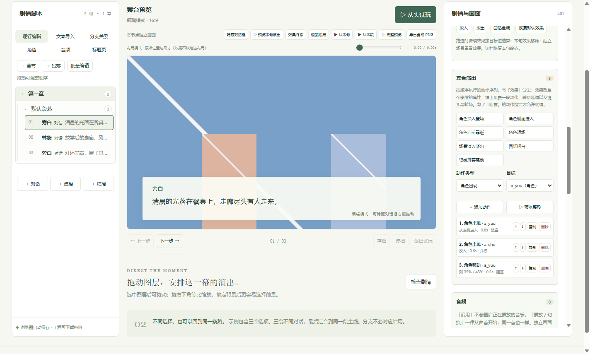
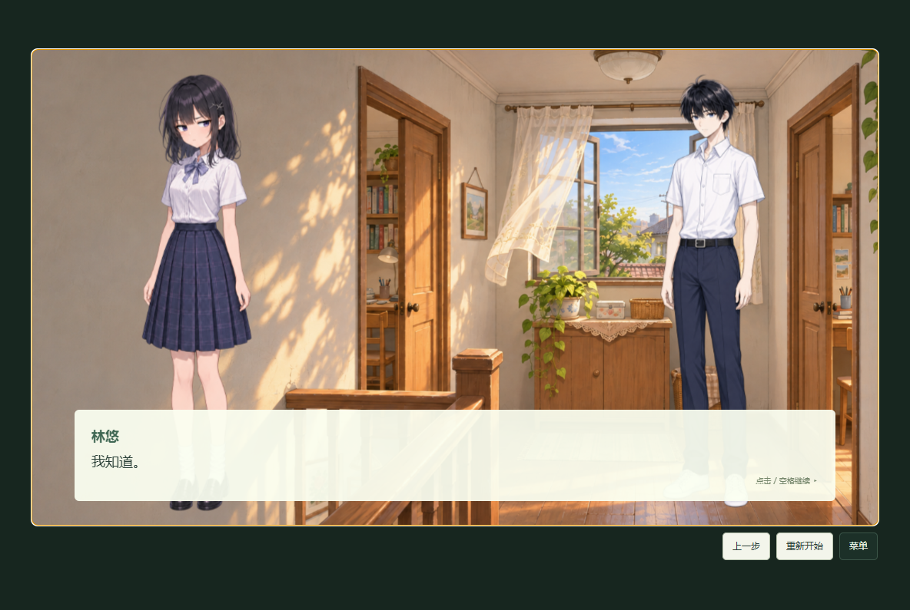
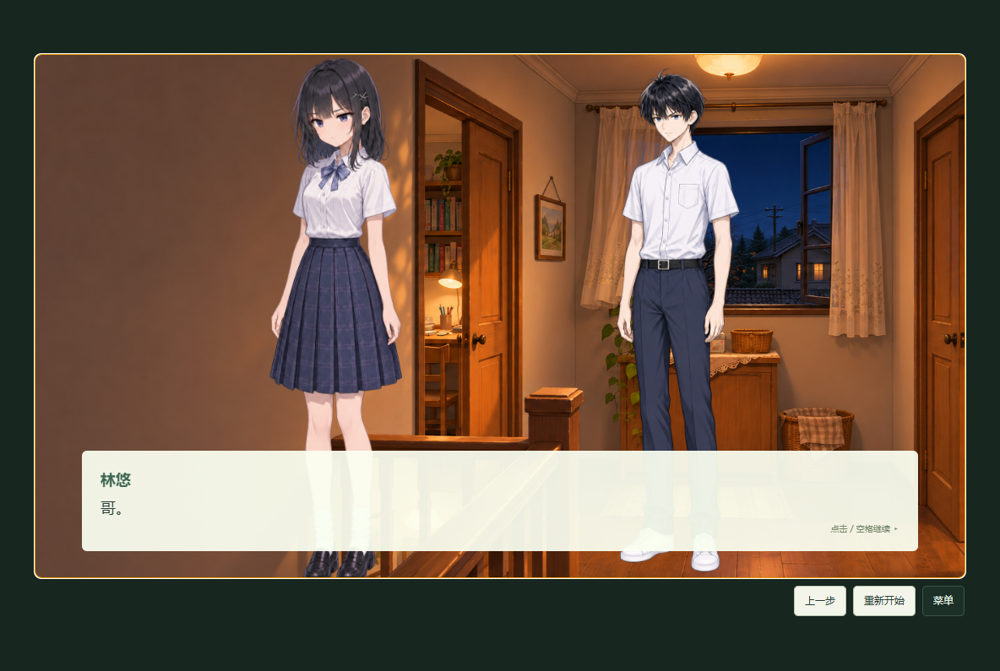
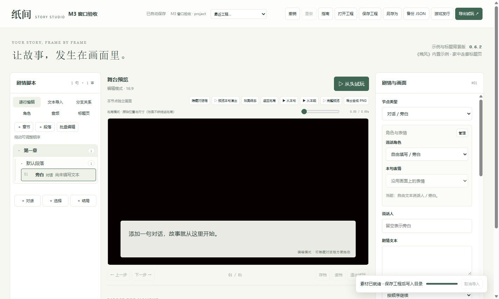
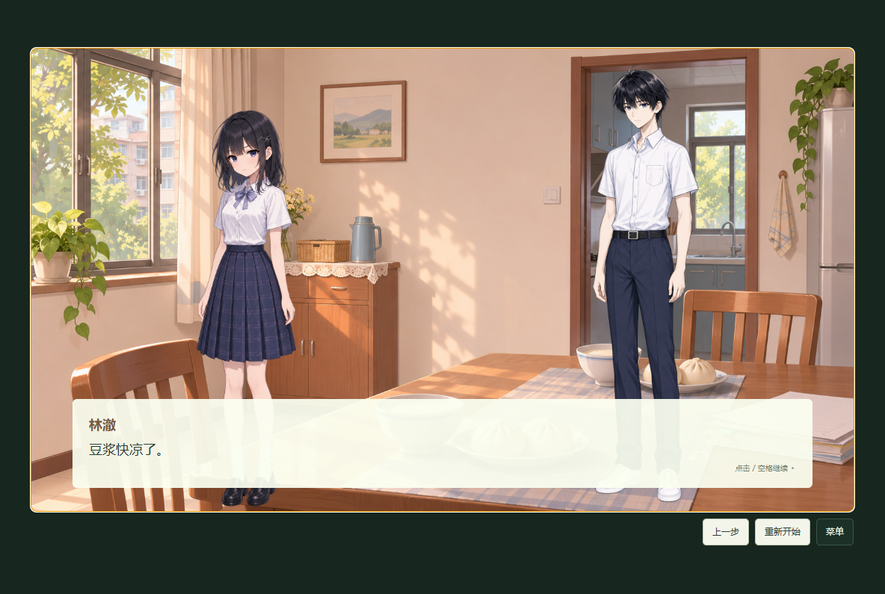

# 纸间 PaperVNStudio

<p>
  
  
  
  
</p>

**一个跑在本地的视觉小说（Galgame / 文字冒险）创作工具。** 左边排剧情，右边摆图层，逐句加演出，最后导出成一个双击就能玩、断网也能玩的作品——不需要服务器，不需要账号，工程就是你自己的一个目录。


> **V0.8.0 已发布。** 新增「舞台演出」：角色登场 / 离场 / 移动 / 缩放 / 表情、背景转场、镜头推拉、闪白与震动，
> 用「顺序 · 并行 · 阻塞」编排成一段动作序列。跳过动画与正常播完必然是同一个终态，编辑器、完整预览、
> 单文件 HTML、独立游戏共用同一套运行时。
> [下载最新版](https://github.com/hjw200775-ops/PaperVNStudio/releases/latest) · [更新日志](CHANGELOG.md) · [演出架构](docs/V0.8.0_STAGE_PERFORMANCE.md) · [编辑器教程](docs/STAGE_PERFORMANCE_GUIDE.md) · [验收报告](docs/V0.8.0_ACCEPTANCE_REPORT.md)

## 下载

| 版本 | 你能拿到什么 | 入口 |
| --- | --- | --- |
| **V0.8.0（最新）** | 演出系统的源码、测试与《晚风》演出优化试玩版构建脚本 | [Releases › v0.8.0](https://github.com/hjw200775-ops/PaperVNStudio/releases/tag/v0.8.0) |
| V0.7.6 | 源码、流式素材测试、1 GiB 生成脚本与验收数据 | [Releases › v0.7.6](https://github.com/hjw200775-ops/PaperVNStudio/releases/tag/v0.7.6) |
| V0.7.5 | 《晚风》第一章节选单文件试玩 HTML（23.6 MB） | [Releases › v0.7.5](https://github.com/hjw200775-ops/PaperVNStudio/releases/tag/v0.7.5) |
| V0.7.3 | 纸间便携版 EXE（126 MB）+ 试玩 HTML | [Releases › v0.7.3](https://github.com/hjw200775-ops/PaperVNStudio/releases/tag/v0.7.3) |
| V0.7.1 / V0.7.0 | 《晚风》独立游戏包：目录版 ZIP、单文件便携 EXE | [Releases › v0.7.1](https://github.com/hjw200775-ops/PaperVNStudio/releases/tag/v0.7.1) |
| V0.6.2 及更早 | 便携版 ZIP + 示例 HTML | [全部版本](https://github.com/hjw200775-ops/PaperVNStudio/releases) |

产物面向 Windows 10/11 x64；**未代码签名**，首次运行若出现 SmartScreen 提示，选「更多信息 → 仍要运行」。不想下载二进制就从源码跑：`npm install && npm run desktop`。

## V0.8.0 新增：舞台演出（Stage Performance Engine）

V0.7 的「效果」只能描述「一句之内、某个图层怎么变」。要做真正的演出，还需要另一件事：
**一串有先后关系的动作**——她从左边走上来（此刻不许翻页），背景同时淡到夜晚，镜头缓缓推近。

- **14 种声明式动作**：角色出现 / 离场 / 移动 / 缩放 / 透明度 / 表情 / 上下浮动，背景切换（6 种转场），
  镜头平移 / 缩放，全屏渐暗、闪白、震动，等待。没有「执行脚本」这一项——剧情里写不进 JavaScript。
- **顺序 · 并行 · 延迟 · 阻塞**：关系是相对上一条动作的，拖动列表就能改语义；勾了「阻塞」的动作演完才允许翻页。
- **跳过 = 播完**：整段演出是「状态 + 时间 → 画面」的纯函数，`t = ∞` 即终态，所以点击跳过得到的画面
  与看完完全一致；读档、后退、切章靠重放 trail 得到同一份状态，存档格式没有变。
- **一套运行时，四个出口**：编辑器试玩、完整预览、单文件 HTML、独立游戏共用 `performance.js`；
  演出写内层 `.pf-frame`，旧的图层效果写外层 `.visual-layer`，互不覆盖。
- **7 个预设**：角色淡入登场、侧面进入、向前靠近、退场，场景淡入淡出，回忆闪白，轻微震动——
  预设只生成标准动作，生成后随便改。

| 验收（真实 Electron 窗口 / 1 GiB 工程） | 实测 |
| --- | --- |
| 《晚风》三场景演出样板（清晨的相遇 / 放学后的走廊 / 夜晚的房间） | 37 句 / 54 个动作 / 预计 2 分 23 秒，单文件试玩 29.6 MB |
| 阻塞演出点击语义 | 第一次点击结算动画不跳句，第二次才推进；终态与播完一致 |
| 编辑器 vs 完整预览 vs 读档重建 | 角色位置误差 < 0.4%、缩放一致、镜头缩放一致、背景一致 |
| 1 GiB 工程（1,577,977,792 bytes / 576 节点 / 12 章） | 打开 0.57 s；演出期间 fps 99、最差帧 59 ms；峰值内存 629 MB |



三场景样板见下方截图；架构与取舍见 [docs/V0.8.0_STAGE_PERFORMANCE.md](docs/V0.8.0_STAGE_PERFORMANCE.md)，
上手步骤见 [docs/STAGE_PERFORMANCE_GUIDE.md](docs/STAGE_PERFORMANCE_GUIDE.md)，
数据与证据见 [docs/V0.8.0_ACCEPTANCE_REPORT.md](docs/V0.8.0_ACCEPTANCE_REPORT.md)。

<table>
  <tr>
    <td></td>
    <td></td>
  </tr>
  <tr>
    <td align="center">清晨的相遇：侧面进入 + 表情切换 + 镜头推近</td>
    <td align="center">夜晚的房间：夜景转场 + 双人站位 + 缓慢推近</td>
  </tr>
</table>

## V0.7.6 新增：素材流式导入与 1 GiB 工程

旧链路的瓶口很具体：图片与音频被读成 Base64 塞进工程对象，素材越多字符串越长，91 MB 就顶到 V8 的单字符串上限。这一版把它拆成两半。

- **运行时只持有地址**：打开工程改用 `paper://app/asset/…` 受控 URL，《晚风》示例的运行时 JSON 从约 21 MB 降到 **34 KB**。
- **导入即落盘**：主进程流式读取 + 分块 SHA-256，落到 `userData/asset-staging/<sha256>.<ext>`；渲染进程只拿到 URL、哈希、大小、MIME 与尺寸 / 时长。背景、立绘与表情、标题背景、CG、BGM、SFX、Voice 八类入口全部改造，支持批量、进度、取消与逐条错误。
- **跨表示精确去重**：已落盘素材、暂存素材、旧工程 data URI 统一按 SHA-256 比对；改名同内容、同名不同内容都能正确判断，复用断言恢复为 `reused === true` 的成功语义。
- **暂存生命周期**：当前工程 + 撤销栈 + 重做栈共同保护，`asset:gc` 只清理无引用且过期的文件；取消、失败中断、关窗不保存、异常退出、另存为都不留悬空地址。

| 1 GiB 真实验收（1,576,200,076 bytes / 204 个哈希 / 12 章 576 节点） | 实测 |
| --- | --- |
| 14 阶段：导入 → 编辑 → 切章切场景 → 立绘背景 → BGM/SFX/Voice → 撤销重做 → 保存 → 重开 → 预览 → 目录版导出 → 启动导出游戏 | 全通过，0 问题，0 条 CDP 运行时异常 |
| 峰值内存（214 个采样点覆盖全部阶段） | 主进程 514.8 MB / 渲染 324.5 MB / 全部 Electron 进程 1,118 MB |
| 工程 JSON 运行时大小 | 约 523 KB（不含 Base64） |
| 打开 / 保存 / 重开 | 1.4 s / 1.1 s / 3.0 s |
| 完整预览 / 目录版导出 / 导出游戏启动 | 4.0 s / 4.0 s / 2.3 s |

<table>
  <tr>
    <td></td>
    <td></td>
  </tr>
  <tr>
    <td align="center">导入即落盘：素材就绪后再写工程</td>
    <td align="center">同一套播放器：预览 / HTML / 独立游戏</td>
  </tr>
</table>

架构与取舍见 [docs/V0.7.6_RESOURCE_ARCHITECTURE.md](docs/V0.7.6_RESOURCE_ARCHITECTURE.md)，验收证据见 [docs/V0.7.6_ACCEPTANCE_REPORT.md](docs/V0.7.6_ACCEPTANCE_REPORT.md)。项目基于 V0.3 网页版源码演进，没有重写编辑器，也没有把网页版推倒重来。

## 版本历史

按时间倒序。最新版本的能力见上文，这里保留每个版本当时的说明与兼容提示。

<details>
<summary>V0.6.2 新增：内置示例与标题背景
</summary>

### V0.6.2 新增：内置示例与标题背景

左栏新增「标题页」标签。标题背景可以选一张已导入的背景素材，也可以直接导入图片；配置只保存素材 ID，随工程一起保存、另存为、备份恢复、撤销重做与导出，清除后回到默认标题页样式。标题图按 cover 保持比例，左侧加了一层渐变保证标题与按钮的对比度；文字仍由程序渲染，缩放窗口不会糊。素材被删除后标题页回退默认样式并明确提示，导出不会失败。

同一标签页提供《晚风经过二楼走廊》内置示例（第一章原作节选 · 45 个节点，原作：黄嘉文）。「体验示例」在独立窗口用与导出完全相同的播放器从标题页开始，拥有自己的持久存储分区与稳定示例身份，可反复体验并读到同一份存档，不改动当前工程、草稿、最近工程与模板文件；「复制示例开始创作」把模板复制到你选择的空白目录，生成新的工程 ID 后作为普通工程打开，取消、目录非空或写入失败都不会留下被当成成功的半成品。网页版不能选目录，只提供「下载示例工程」。详见 [docs/V0.6.2_SAMPLE.md](docs/V0.6.2_SAMPLE.md)。

示例只捆绑 45 节点原作、7 张原作素材、1 张家中走廊标题图和一份素材说明，不含备份、测试报告、截图或英文占位语音。标题图与正文学校走廊是两回事：正文各句场景保持不变。

**兼容提示**：`titleBackground` 是可选的增量字段，新版读旧工程仍然正常；但旧版本保存含标题背景的工程时会静默丢弃这个字段（标题图丢失，工程仍可打开）。老工程素材缺失不阻断打开，只在检查里报告。

本版仍不做独立游戏 EXE、多槽存档、主题编辑器、AI、TTS 或自动播放。

</details>

<details>
<summary>V0.6.1 新增：标题页与游戏菜单
</summary>

### V0.6.1 新增：标题页与游戏菜单

导出的作品打开后先显示标题页：游戏标题、开始游戏、继续游戏、设置。没有有效存档时「继续游戏」禁用并说明原因；开始游戏从首节点启动，不删除已有存档；有进度时重新开始会先确认。游戏内提供「菜单」按钮与 Esc：返回游戏、保存进度、读取进度、设置、返回标题；结局画面同样可用。

菜单打开时暂停剧情推进与选项快捷键，但当前 BGM、语音、音效和视觉演出继续；设置里的音量实时生效、不重启声音；菜单开关不会重新进入当前句。返回标题会取消演出、停止全部游戏音频与延迟任务、清空本次会话，保留存档与音量偏好。继续游戏按存档节点与真实 trail 恢复效果和 BGM；损坏、节点删除或路径失效的存档只禁用「继续」并保留原数据。

编辑器保留「从本句 / 从本段试玩」的快捷流程；另加「完整预览」，用同一份自包含 HTML 在独立窗口跑标题页、菜单、设置与存读档。详见 [docs/V0.6.1_PLAYER.md](docs/V0.6.1_PLAYER.md)。

本版仍是单槽手动存档，不新增自动存档、多槽、快进、文本回顾或独立游戏 EXE。

</details>

<details>
<summary>V0.5 新增：基础音频
</summary>

### V0.5 新增：基础音频

左栏「音频」可以导入背景音乐、音效和台词语音（可靠支持 PCM WAV），按内容复用素材、异步读取时长、试听与停止试听；删除被引用素材时会列出引用位置并默认阻止。右侧新增独立的「音频」分区：每句可选「沿用 / 播放或切换 / 停止」音乐，设置音量、循环、淡入淡出；添加多条音效（音量、触发延迟）；手动绑定一条台词语音。分类音量与静音是本机播放偏好，不写进工程。

编辑器试玩与导出 HTML 共用同一套音频指令与运行层：正常推进沿用当前音乐播放位置，显式播放从头开始（同一首也一样）；切句停止旧语音、未结束的音效与尚未触发的延迟任务；返回、读档、重开按目标句状态从曲首重建。音频状态沿**真实路线**推导，独立画面不会清除此前播放过的音乐，路线不确定时让作者选择。音频单独存到 `assets/audio/<sha256>.<ext>`，导出 HTML 内嵌音频并提示增加的体积，断网可播放；浏览器首次播放需点击「启用声音」。详见 [docs/V0.5_AUDIO.md](docs/V0.5_AUDIO.md)。

**兼容提示**：含音频的工程请勿用 V0.4.3 及更早版本保存——旧版不认识音频素材列表，保存后会丢失全部音频素材，台词里的音频指令会变成失效引用。请保留工程备份，只在 V0.5 及以上版本编辑。

本版不做 TTS、自动配音、口型同步、音频剪辑、复杂时间轴、批量音频绑定、云服务或独立游戏 EXE。测试素材里两条英文语音只是功能占位，未绑定进正式中文原作。

</details>

<details>
<summary>V0.4.3 新增：批量编辑
</summary>

### V0.4.3 新增：批量编辑

一次勾选多句（Shift 连选、整段全选、折叠段落保留选择），批量设置说话角色与表情、指定在场角色的表情；复制某句的独立场景布局或演出，粘贴到所选句子并可选择替换或追加。所有写入先出预览：能改几句、跳过几句、冲突几句、前几句的前后对照与原因；应用后整批一次撤销、一次重做。详见 [docs/V0.4.3_BATCH.md](docs/V0.4.3_BATCH.md)。

</details>

<details>
<summary>V0.4.2 新增：章节与段落
</summary>

### V0.4.2 新增：章节与段落

长剧情可以整理成「章节 → 段落 → 句子」：折叠展开、显示句数、拖动或「移动到…」调整位置，当前句始终可见。章节顺序就是播放顺序，改动会改变「按顺序继续」时先列出受影响的句子；删除章节或段落默认保留剧情。文本导入先出预览（识别 `# 章节`、`## 段落`、`角色：台词`，列出来不及识别的行），确认后一次撤销即可还原。剧情检查的错误与提示可以点击直接跳到对应句子；「从本句 / 从本段试玩」会按前面的句子还原背景、表情与持续演出。详见 [docs/V0.4.2_CHAPTERS.md](docs/V0.4.2_CHAPTERS.md)。

</details>

<details>
<summary>V0.4.1 新增：角色与表情
</summary>

### V0.4.1 新增：角色与表情

作者可以建立「林悠」「林澈」这样的角色，填姓名与姓名颜色，为每人添加多个表情（整图变体）。录台词时选择谁在说话、本句用哪个表情；同场另一个角色也能单独设表情。切表情只替换现有角色图层的素材关联，坐标、尺寸、图层 ID、层级、透明度与演出绑定都不动，也不会把表情写回别人的分支。

旧 V0.1 / V0.2 / V0.3 工程会自动升级到 `schema 4`，不按说话人文字猜人物；角色改名不影响已录入的台词。详见 [docs/V0.4.1_CHARACTERS.md](docs/V0.4.1_CHARACTERS.md)。

</details>

## 它能做什么

| 能力 | 说明 |
| --- | --- |
| 剧情编辑 | 对话、选项分支、分支再汇合、结局节点；章节/段落分组，折叠与拖动整理；TXT 导入带预览；多选批量改角色/表情、复用场景与演出 |
| 多图层画面 | 背景与角色立绘分层，拖动、缩放、排序、锁定、隐藏；同一张图既能当背景也能当角色 |
| 逐句演出 | 缩放、移动、透明度、模糊、亮度、对比度、饱和度和旋转，按句设置延迟与时长 |
| 效果恢复策略 | 持续保持 / 本句结束恢复 / 自动恢复；带角色特写、背景虚化等预设 |
| 场景继承 | 节点可继承上一句的画面，也可独立成场；可存成预设复用 |
| 角色与表情 | 角色有稳定 ID 与姓名颜色，每角色可挂多个表情；台词按角色选表情，同场两人可各自切换 |
| 基础音频 | BGM 沿用 / 切换 / 停止、音量与循环与淡变、多条音效与延迟、逐句台词语音；总 / 分类音量与静音；统一运行层与解锁入口 |
| 标题页 | 标题背景可选已有素材或导入图片，引用素材 ID；缺失自动回退默认样式；导出与完整预览同一套标题页/菜单/设置 |
| 内置示例 | 《晚风经过二楼走廊》第一章节选（45 节点）可直接体验（独立分区存档）或复制成新工程创作 |
| 工程管理 | 工程是一个目录，图片与音频复制进工程内，移动整个目录仍可打开；自动保存副本 + 最近一次成功保存的备份 |
| 导出 | 自包含 HTML：图片与音频内嵌、不依赖本机路径、不需要联网，双击即可试玩；导出前提示音频体积 |

## 两种运行方式

**网页版**：`npm start` 后打开 `http://127.0.0.1:4173/`。只监听本机，草稿存在浏览器里。

**桌面版（Windows 预览）**：`npm run desktop`，或直接运行打包好的便携版 EXE。桌面版才具备本地工程目录、备份与启动恢复。

## 快速开始

```powershell
npm install                  # 首次；依赖版本已固定在 package-lock.json
npm start                    # 网页版 → http://127.0.0.1:4173/
npm run desktop              # 桌面版窗口（不需要先启动网页服务）
npm run check                # 语法检查 + 全部测试
```

打包 Windows 产物：

```powershell
npm run build:win            # 便携版 + NSIS 安装包，输出到 release/
npm run build:win:portable   # 只出便携版
npm run build:win:installer  # 只出 NSIS 安装包
```

打包脚本默认把 Electron 本体与 NSIS / winCodeSign 工具链从 npmmirror 镜像下载，避免直连 GitHub Release 超时；想用官方源时，把环境变量 `ELECTRON_MIRROR`、`ELECTRON_BUILDER_BINARIES_MIRROR` 设成官方地址即可。

## 连不上 GitHub 时

先跑一次体检，它会指出是哪一层出了问题：

```powershell
npm run net:check
```

常见情况与处理：

1. **github.com 解析到了不通的 IP**。体检会打印「DNS 解析」与「实际连接 IP」，并逐个试已知边缘 IP。若给出可用的，把它写进 `C:\Windows\System32\drivers\etc\hosts`（需管理员），再 `ipconfig /flushdns`：
   ```
   20.27.177.113   github.com
   ```
   撤销就是删掉这一行再刷新 DNS。GitHub 换了 IP 时换用体检列出的其它地址。
2. **raw.githubusercontent.com 不通**。这是 GitHub 的原始文件分发域，常被整体阻断，改 hosts 无效。改用镜像：`https://ghfast.top/<原 raw 地址>` 或 `https://cdn.jsdelivr.net/gh/<用户>/<仓库>@<分支>/<路径>`。
3. **Release 资产不通**（Electron、NSIS 下载失败）。用上面打包脚本内置的镜像，或手动设 `ELECTRON_MIRROR=https://npmmirror.com/mirrors/electron/`。
4. **git 报 `Could not connect to server`**。先确认没有残留的失效代理：`git config --global --get http.proxy` 应为空，`netsh winhttp show proxy` 应为「直接访问」。github.com 能连时不要给 git 设代理，代理客户端退出后反而会让所有 git 操作失败。

## 工程目录

「新建 / 另存为」会创建一个工程目录：

```
我的故事/
├── project.paper.json           # 版本化元数据：剧情、图层、效果、预设
├── assets/images/<sha256>.<ext> # 内容寻址素材，同一张图只存一份
└── backups/
    ├── latest/                  # 最近一次成功保存
    └── autosave/                # 崩溃恢复用的自动保存副本
```

保存顺序是「素材先写、元数据后写」，元数据用原子替换，失败会回滚；打开时若主文件损坏，会从 `backups/latest` 恢复并校验素材 sha256。旧版单文件 `.paper.json` 可通过「打开工程 → 旧 .paper.json 文件」导入，原文件只读。

## 项目结构

| 路径 | 用途 |
| --- | --- |
| `dist/` | 编辑器页面与运行时：`app.js` 编辑状态与图层操作，`core.js` 校验/迁移/场景解析，`effects.js` 效果插值与渲染，`player.js` 导出游戏播放器，`export.js` 自包含导出，`game-html.js` 唯一的「工程 → 播放器 HTML」入口 |
| `dist/samples/` | 内置只读示例（`wanfeng-ch01/`：45 节点原作 + 家中走廊标题图 + 素材说明） |
| `desktop/` | Electron 主进程、`paper://` 白名单协议、窄 IPC，以及工程目录读写与备份 |
| `game/` | 《晚风》示例包专用：图标源与 9 档 ICO（V0.7.1 构建脚本仍用它） |
| `desktop/game-shell/` | 通用游戏播放器壳：读 `content/game.json`，按 `releaseId` 隔离存档，无 preload/IPC |
| `desktop/game-builder.cjs` + `game-pack-worker.cjs` | 通用导出：主进程生成内容与图标，子进程复制运行时、rcedit、ZIP/NSIS |
| `tests/` | 核心逻辑、效果、存储、素材去重、导出、安全边界、工作区卫生 |
| `scripts/` | 无依赖本地服务、检查入口、桌面启动与真实窗口烟测；`build-game-package.cjs` / `game-package-acceptance.cjs` 负责独立游戏包的构建与成品验收，`zip-writer.cjs` / `zip-manifest.cjs` 负责 UTF-8 文件名的 ZIP 读写 |
| `docs/` | 迁移路线、交付说明、验收清单、已知限制 |

设计上的几条硬约束：渲染进程 `contextIsolation` + `sandbox`，没有 Node 访问；页面只从 `paper://` 白名单加载；IPC 通道固定并校验发送方；素材按内容哈希命名，不覆盖、不信任外部路径。

## 测试与验收

验收分四层记录，不把「脚本跑过」当成「人点过」：

| 层级 | 含义 | 命令 |
| --- | --- | --- |
| 自动化 | Node 测试与静态检查 | `npm run check` |
| 可见渲染 | 真实 Electron 窗口里驱动界面并断言 DOM 与落盘 | `npm run desktop:smoke`、`desktop:smoke:project`、`desktop:smoke:packaged`、`sample:acceptance` |
| 游戏包成品 | 解压 ZIP、启动真实 EXE、通关 / 存档 / 移动目录 / 存储隔离 / ZIP 清单 | `npm run game:acceptance` |
| 播放器交互 | 双击 / 拖选 / 拖立绘 / 单击推进 / 选项 / 音量滑块 / 创作模式 | `npm run interaction:acceptance` |
| 1 GiB 工程全链 | 真实窗口 12 步 + 目录版游戏启动 + 持续内存采样 | `npm run m3:acceptance`、`npm run m3:memory-profile` |
| 真实作品兼容性 | 三个《晚风》Alpha 工程隔离副本 6 步验收 | `npm run m3:alpha` |
| 人工点击 | 原生对话框、未保存关闭三选一、安装向导 | 人工，**尚未执行** |
| 副机验收 | 另一台干净机器断网打开 EXE 与导出 HTML | 人工，**尚未执行** |

`desktop:smoke` 用真实主进程和真实 IPC 跑完整链路：导入图片 → 图层 → 修改布局与效果 → 自动保存 → 显式保存 → 重新打开 → 导出 HTML。烟测工程一律建在系统临时目录，源码树不接收任何工程产物。

## 工程资源架构（V0.7.6-M3，已完成）

编辑器**全程不持有素材字节**：导入时主进程流式读取 + 分块 SHA-256，落到 `userData/asset-staging/<sha256>.<ext>`，渲染进程只拿到受控 URL 与元数据；保存时按哈希把素材流式复制进工程目录，运行时地址变成 `paper://app/asset/assets/images/<sha256>.png`，舞台按需读取。撤销/保存/预览/导出都只处理元数据。

```bash
npm run check                              # 含素材去重 / 生命周期 / 兼容性回归
node scripts/make-large-project-m3.cjs --out F:/pvn-1gib-m3   # 生成 1 GiB 级测试工程
node scripts/m3-acceptance.cjs             # 真实 Electron 窗口 12 步验收 + 内存采样
node scripts/memory-profile.cjs            # 汇总 release/memory-profile.json
node scripts/alpha-acceptance.cjs          # 三个《晚风》Alpha 工程隔离副本验收
npm run assets:probe 9335                  # 连已运行的编辑器，检查图片是否走资源协议并截图
```

- 素材入口全覆盖（背景、立绘、表情、标题背景、CG、BGM、SFX、Voice）：单文件与批量导入都有进度、取消与错误提示，不再把完整素材转成 Base64 传给渲染进程。
- 内容寻址去重：同一文件重复导入、改名同内容、已保存素材与新导入都能精确复用；`audio-store` 的跨表示断言已恢复为 `reused === true`。
- 暂存生命周期：当前工程 + 撤销栈 + 重做栈共同保护暂存文件，取消/失败/关闭不保存/异常退出/另存为都不会留下悬空资源地址。
- 《晚风》示例：运行时工程 JSON 从约 21 MB 降到 **34 KB**；1 GiB 压力工程运行时 JSON 约 **523 KB**。
- 单文件 HTML 导出时才把资源读回 data URI，超过 **200 MB** 会提示改用独立游戏目录 / ZIP；1 GiB 工程走目录版。
- **1 GiB 级实测**：1,576,200,076 bytes 去重素材（100 图 + 104 曲 / 204 个不同哈希 / 12 章 576 节点），真实窗口完成导入→编辑→播放→撤销→保存→重开→预览→目录版导出→启动导出游戏，全程无 `Invalid string length`、无 OOM、无素材损坏。峰值：主进程 514.8 MB、渲染进程 324.5 MB、全部 Electron 进程 1,118 MB（214 个采样点）。
- 三个《晚风》Alpha 工程已用隔离副本完成 3/3 兼容性验收，原始作品未被改动（更正此前「工程缺失」的误报）。

详见 [docs/V0.7.6_RESOURCE_ARCHITECTURE.md](docs/V0.7.6_RESOURCE_ARCHITECTURE.md) 与 [docs/V0.7.6_ACCEPTANCE_REPORT.md](docs/V0.7.6_ACCEPTANCE_REPORT.md)；遗留边界见 [docs/KNOWN_LIMITATIONS.md](docs/KNOWN_LIMITATIONS.md)。

## 大型游戏发布（V0.7.5）

独立游戏不再把素材塞进一个 HTML：产物是「EXE + resources/app/content」，播放器页面只有几百 KB，图片与音频按内容哈希落在 `content/assets/`，运行时由 `papergame://` 受控读取。

```bash
npm run export:large            # 用 218MB 合成工程真实导出目录版 / ZIP
npm run game:folder-smoke -- "<游戏目录>"   # 启动产物，验证资源协议与播放
```

- 三种形态：单文件 HTML（小型作品）、独立游戏目录（推荐，支持大型资源）、ZIP 发布包。
- 先按引用裁剪再落盘：未引用的备用素材留在工程里，不进包。
- 素材逐字节复制，不转码不重压缩；路径相对包内，移动目录照常启动。
- `MAX_CONTENT_BYTES` 保留，但现在只约束播放器页面本身。

细节、体积对比与容量上限（约 300 MB，受工程格式限制）见 `docs/V0.7.5_GAME_EXPORT.md`。

## 大型工程预览（V0.7.4）

完整预览不再把整份自包含 HTML 传给主进程：编辑器只发工程数据，主进程把素材落到预览会话目录，页面通过 `pvres://` 按需读取。素材总量不再撑大 HTML，旧 64MB 限制自然消失。

```bash
npm run preview:acceptance        # 大型工程预览验收（合成 218MB 工程）
npm run resources:report          # 任意工程的「素材库 / 引用 / 未引用」清单
npm run make:large-project        # 生成合成大型工程（默认 F:/pvn-large-project）
```

- 预览会话目录 `userData/preview-sessions/s-<id>/`，关闭窗口即删，启动时清残留。
- 图片与音频都走受控协议（只认活跃会话、路径锁定在会话目录内，HTML 带 CSP）。
- 导出按引用收图片与音频，`manifest.resources` 记录数量与字节；单文件 HTML 仍可断网运行。
- 编辑器的「舞台预览」旁会显示准备 / 生成 / 加载 / 失败状态。

细节、实测数据与未验证项见 `docs/V0.7.4_LARGE_PROJECT.md`。

## 音乐素材库与场景配乐（V0.7.3）

六首正式 OST 已进内置示例的素材库，当前剧情只用其中三首（标题、早晨、上学路）：

```bash
npm run music:import        # 从素材包导入/替换六首 BGM（按曲目 ID，绑定关系不动）
npm run music:acceptance    # 断网下的标题曲、场景曲、继承与资源释放
```

- 素材库按分类与情绪标签筛选，行内试听；「绑定到场景」只写段落入口，后续句子继承，不逐句重启。
- 标题界面有独立音乐槽位：进入游戏暂停、返回标题续播，不与场景 BGM 叠加；退出时释放音源。
- 导出只内嵌被引用的曲目（当前 3 首），其余留在工程里，清单列出包含 / 排除。
- 换完整版按 `trackId` 替换音源，素材 id 不变，剧情与标题音乐绑定全部保留。

细节与未验证项（循环接缝尚未人工听审）见 `docs/V0.7.3_MUSIC_LIBRARY.md`。

## 通用独立游戏导出（V0.7.2）

任何作者都能在图形界面里把自己的工程导出成 Windows 游戏，不需要安装 Node.js、Electron，也不用敲命令：

1. 打开工程 → 右上角 **游戏发行**；
2. 填游戏名称（默认取工程名）、作者、版本、版权，按需导入图标（PNG / JPEG / ICO），设置窗口大小、是否缩放、窗口 / 全屏；
3. 选「ZIP 解压版」或「单文件便携 EXE」→ 导出到一个新文件夹。

```bash
npm run tools:prepare              # 从本机缓存收集 rcedit + NSIS（约 3MB，随纸间分发）
npm run export:acceptance          # 两套工程走 GUI 导出 + 真机游玩验收
npm run export:acceptance:packaged # 已打包的纸间再跑一遍
npm run interaction:acceptance     # 播放器交互：5 个载体上的真实鼠标手势
```

- 发行设置是**工程内容**：跟着保存、另存为、备份与撤销走；旧工程缺字段时用默认值，HTML 导出不受影响。
- 运行时不另外下载：直接复用正在运行的 Electron；rcedit / NSIS 随纸间分发在 `resources/toolchain`，ZIP 导出可完全离线。
- 每个作品有稳定的发行标识，存档在 `%APPDATA%\PaperVNStudio-Game-<标识>`；同名不同工程也不会共用存档。
- 构建在子进程里跑，界面不卡；可以取消，失败或取消都不会动已有产物。
- 玩家端禁选区：标题页、舞台、台词、选项与菜单不出蓝色选区，立绘和背景不可拖成缩略图；设置面板的滑块与输入框照常可用。规则只挂在共享播放器的结构容器上，所以编辑器试玩、完整预览、HTML、ZIP、单文件行为一致；编辑器创作模式仍可选中台词、拖动素材。
- 点击与拖动分开：按住拖动超过 8px 不推进剧情，避免拖选时无故跳句。

细节、两套工程的实测结果与已知限制见 `docs/V0.7.2_GAME_EXPORT.md`，界面截图在 `docs/screenshots/`。

## 独立游戏包（V0.7 正式版）

把内置示例《晚风经过二楼走廊》做成「双击 → 断网可玩」的 Windows x64 发布包，同时提供两种形态：

```bash
npm run game:icon         # 改图标后运行：SVG → 16–256 九档 ICO（产物已入库）
npm run game:build        # → ZIP + 单文件便携 EXE + manifest.json（含各自 SHA-256）
npm run game:acceptance   # 解压 ZIP 跑真实 EXE，并单独验收单文件便携版
```

- 内容复用 `dist/game-html.js` + `player.js` 的唯一导出路径，不另写一套拼接逻辑；标题图、正文、`road_17` 演出与原作一致，不带测试音频。
- 游戏身份独立：`cn.papervnstudio.game.wanfeng-ch01`，userData 在 `%APPDATA%\PaperVNStudio-Game-wanfeng-ch01`，与纸间编辑器、内置示例分区互不共用；移动目录、换用单文件版都不影响读档。
- 播放器壳 `sandbox` + `contextIsolation`、无 Node / 无 preload / 无 IPC、`wanfeng://` 白名单只服务包内 HTML、所有网络请求取消。
- 应用图标是矢量源（`game/icon/icon.svg`）渲染的 9 档 ICO；EXE 写入产品名、公司、版本、版权与商标。
- 签名走 `CSC_LINK` / `CSC_KEY_PASSWORD`，由 electron-builder 完成；没有证书时构建如实标记 `signed: false`，不伪造信任。
- 通用「导出 Windows 游戏」按钮、NSIS 安装包、自动更新留到下一阶段。

细节、实测结果与未验证项见 `docs/V0.7_GAME_PACKAGE.md`。

## 当前状态

- 已完成：网页版基线、桌面窗口与工程存储、可靠保存与备份、离线导出、V0.3.1 收尾修复、V0.6.2 内置示例与标题背景、V0.7《晚风》正式版（图标、版本信息、双形态、签名管线）、V0.7.2 通用独立游戏导出（发行设置、图标、ZIP / 单文件、离线构建组件）与播放器交互修复（禁选、禁拖、点击/拖动分离）、V0.7.3 音乐素材库与场景配乐（六首 OST、标题音乐、按引用导出）、V0.7.4 大型工程预览（会话目录 + pvres:// 按需读取）、V0.7.5 大型游戏发布（资源分离目录版 / ZIP）、**V0.7.6 素材流式导入与 1 GiB 级工程验收**（内容寻址去重、暂存生命周期、持续内存采样、三工程 Alpha 隔离副本验收）。
- 未开始：NSIS 安装包、真实证书签名（等证书）、多槽存档、剧情变量、AI 辅助、自动更新、macOS / Linux 导出。
- 已发布的 Windows 产物在 [Releases](https://github.com/hjw200775-ops/PaperVNStudio/releases) 下载（便携版 / 独立游戏包 / 试玩 HTML，附 SHA-256 或逐文件校验）；`release/` 本身是忽略目录，不随仓库分发。也可自行 `npm run build:win`。
- V0.7.6 **不提供**打包产物，只发源码与验收证据：1 GiB 素材本体不入库，需要复现时用 `scripts/make-large-project-m3.cjs` 现场生成。

细节见 `docs/DESKTOP_PREVIEW.md`（交付说明与构建记录）、`docs/ACCEPTANCE.md`（验收清单）、`docs/KNOWN_LIMITATIONS.md`（已知限制）。C 层与 D 层怎么一步步点，见 `docs/MANUAL_ACCEPTANCE.md`。

## 授权与素材

代码以 [MIT 许可证](LICENSE) 发布：可以自由使用、修改、再分发，保留版权与许可声明即可。

代码里不包含任何第三方角色图片、字体或语音素材；`docs/SOURCE_PROVENANCE.json` 记录的是原始网页源码的版本与逐文件校验值。使用时请自备有授权的素材，发布前确认素材与字体许可。

用户工程与草稿不在仓库内：工程目录由使用者选定，最近工程列表与崩溃草稿写在 Electron 的 `userData` 目录。
